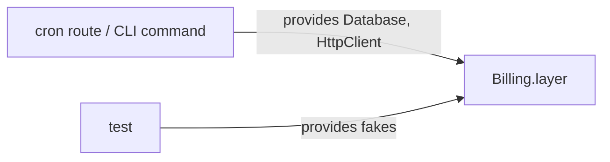
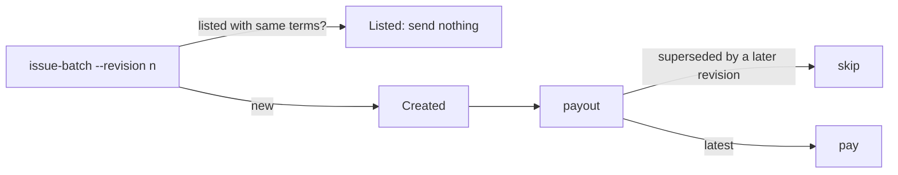

# Examples

Three bodies in the shape of ones the author approved or hand-edited into their final
form. The domain is invented; the shape, density and what is left out are the point.

## Tiny

````markdown
Closes BIL-212

- Invoices regenerate whenever the underlying usage changes.
- No more 24-hour wait between two invoice runs.
````

## Small refactor

No deploy steps, risks or test section: nothing important to say in them.

````markdown
## Summary

A job says what it needs from the outside: a `Database` and an `HttpClient`. The
**host** that runs it, a cron route or a CLI command, provides them. Jobs no longer
build their own connections.

A test can now take a host's real job layer and run it over fakes, so it exercises
the production wiring instead of a lookalike. Each route and command provides the
same connections it used before.

## What's new

- **Jobs declare their needs.** `Billing.layer` and `Usage.layer` leave `Database`
  and `HttpClient` unprovided, and their types say so.
- **Hosts provide them.** The `invoice` and `usage` routes and the matching CLI
  commands each provide one `Database` and one `HttpClient`.
- **Lint keeps it that way.** Importing a connection constructor under `jobs/*/src`
  fails lint.

## How it is built now



1. A job pins which account it acts as. The host supplies the vendor edges.
2. Tests and production compose the same layer; only what is provided differs.
````

## Operational

````markdown
Closes BIL-198

## Summary

A **revision** replaces an invoice batch that went out wrong. The provider cannot edit
a sent batch, so a correction is a new batch that supersedes the old one, and the
payout step pays only the latest revision. On 3 March a currency rounding bug
underpaid 41 accounts, and the only fix was a manual refund per account.

`issue-batch --revision n` now creates the correction, and `payout` skips any batch
a later revision supersedes.

> [!IMPORTANT]
> Batches are found by their terms, not by id. Rerunning `issue-batch` before the
> provider lists the new batch creates a duplicate.

## What's new

- **Revisions.** `issue-batch --revision n` issues a batch that supersedes revision
  `n - 1` for the same accounts and period.
- **Latest revision only.** `payout` pays a batch only when no later revision covers
  its accounts and period.
- **Existence check.** A batch whose terms the provider already lists reports
  `Listed` and sends nothing.

## How it is built now



1. A revision changes only its revision number. Accounts, period and pricing rules
   stay those of the original, which is how `payout` recognises it.
2. A superseded batch keeps its last payout record. Nothing deletes history.

## Decisions

- **Supersede, don't cancel.** The provider has no cancel call for a sent batch.
  Cancelling by hand per account was the March fix, and it does not scale.
- **Open decision:** whether `payout` should also refuse a batch with a duplicate of
  the same revision, or only log it. Waits on the provider confirming their dedupe.

## Before you merge and deploy

Before the merge:

1. Run `make infra-plan`. Expect 1 create (`PAYOUT_REVISION_GUARD`) and nothing else.
2. Run `make infra-apply`, then merge.

Right after the deploy:

3. Run `payout --dry-run`. Expect every March batch `Superseded` and every April
   batch `Pay`.

> [!WARNING]
> Once a revision 1 batch exists in production, reverting this PR makes `payout`
> pay both revisions. Revert only before the first revision is issued.

## Risks

| Risk | Symptom |
| --- | --- |
| `issue-batch` rerun before the provider lists the batch | Two batches with the same revision, both paid |
| Provider lists no exchange rate for a currency | Items fail with `RateUnavailable` |
````
